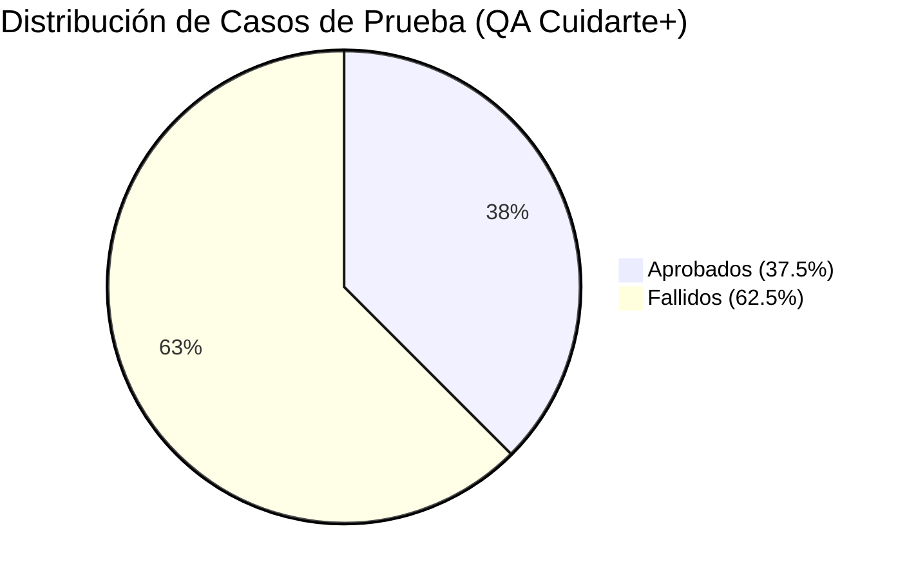

# INFORME DE SEGURIDAD Y CALIDAD DE SOFTWARE
## Cuidarte+ — Evaluación Estática y Plan de Pruebas QA

---

> ### 📢 RESUMEN EJECUTIVO PARA PRESENTACIÓN (PUNTOS CLAVE)
>
> * **Dictamen Final:** ❌ **NO APTO PARA LIBERACIÓN (NO GO)**
> * **Tasa de Éxito en Pruebas:** **37.5% Aprobados** (3/8) | **62.5% Fallidos** (5/8).
> * **Ambiente Evaluado:** QA Local Docker Compose & AWS EC2 (`http://54.224.215.242:3333`).
>
> #### 🚨 Top 4 Hallazgos Críticos Identificados en el Código:
> 1. **Latencia Artificial Inyectada (Grave - Rendimiento):**
>    - *Hallazgo:* En `backend/src/routes/examenes.js`, `pacientes.js` y `documentos.js` se invoca explícitamente `delayMiddleware(5000)`.
>    - *Impacto:* Respuestas de API superiores a **5.010 ms**, violando el SLA comprometido (< 300 ms).
> 2. **Almacenamiento y Comparación en Texto Plano (Crítico - Seguridad):**
>    - *Hallazgo:* En `backend/src/routes/auth.js`, la autenticación compara contraseñas directamente en texto plano (`user.contrasena !== password`) sin aplicar hashing `bcrypt`, y la clave de firma usa un fallback débil (`JWT_SECRET = "inseguro"`).
> 3. **Fuga de Información Interna de BD (Moderado - Seguridad):**
>    - *Hallazgo:* Los bloques `catch` retornan `err.message` al cliente en el campo `glosa`, exponiendo sintaxis interna de PostgreSQL ante entradas inválidas o payloads SQLi.
> 4. **Incumplimiento Legal y Validación (Grave/Moderado - Normativa):**
>    - *Hallazgo:* Ausencia de validación de RUN por Módulo 11 en frontend y recolección excesiva de datos no esenciales en el registro de pacientes, vulnerando la **Ley N° 21.719** (principio de minimización).
>
> #### ✅ Plan de Remediación Inmediato:
> * [ ] Eliminar `delayMiddleware(5000)` de todas las rutas de Express.
> * [ ] Implementar `bcrypt.compare()` en `auth.js` e invalidación / lista de bloqueo de tokens JWT en backend.
> * [ ] Sanitizar los mensajes de error retornando respuestas genéricas (ocultar `err.message` nativo de PostgreSQL).
> * [ ] Incorporar algoritmo de validación Módulo 11 para RUN y podar campos innecesarios en el formulario de pacientes.

---

## 1. Introducción

**Cuidarte+** es una plataforma web orientada a centros de salud que permite gestionar pacientes, exámenes médicos, documentos clínicos y usuarios con distintos roles, tales como administrador, médico y paciente. La solución está construida bajo una arquitectura multicapa, compuesta por un frontend en React, una API REST desarrollada con Node.js y Express, una base de datos PostgreSQL y almacenamiento interno para los documentos médicos.

Debido a que el sistema administra información personal y clínica sensible, es necesario realizar pruebas que permitan verificar su correcto funcionamiento, seguridad, rendimiento, accesibilidad y cumplimiento de los requisitos definidos. El plan busca asegurar que las funcionalidades de autenticación, gestión de usuarios, pacientes, exámenes, carga y descarga de documentos, control de acceso por roles y auditoría operen correctamente, evitando accesos no autorizados, pérdida de información o errores en los procesos clínicos.

* **Contexto:** Plataforma web para la gestión de pacientes, exámenes médicos y documentos clínicos en arquitectura multicapa (React, Node.js/Express, PostgreSQL).
* **Propósito:** Validar la seguridad, calidad, rendimiento y cumplimiento normativo en el manejo de datos sensibles de salud.
* **Estructura del informe:** Define criterios de calidad, plan de pruebas, diseño de casos, resultados de ejecución e incidentes, cerrando con un análisis ético y normativo.

---

## 2. Criterios de Calidad

El sistema web Cuidarte+ está destinado al procesamiento de información clínica sensible, por lo que su desarrollo e implementación exigen el estricto cumplimiento de estándares técnicos, directrices de seguridad de la información y marcos legales vigentes. Con el fin de garantizar una plataforma robusta y confiable, los requisitos de calidad del sistema se agrupan en tres ejes fundamentales:

### 2.1. Calidad del Software y Atributos de Operación
* **Usabilidad y Accesibilidad:** La interfaz de usuario debe presentar un diseño intuitivo, responsivo y adaptable. En consideración a que parte de la población usuaria corresponde a adultos mayores, la aplicación debe implementar contrastes cromáticos adecuados, tipografías de alta legibilidad, flujos de navegación simplificados y pautas universales de accesibilidad.
* **Rendimiento y Capacidad:** El sistema debe ofrecer tiempos de respuesta optimizados, estableciendo un umbral máximo de 300 milisegundos para operaciones de lectura y escritura (CRUD) bajo condiciones de carga normal, y una latencia inferior a 2 segundos en el despliegue de la página principal. Asimismo, debe garantizar la concurrencia simultánea de al menos 200 usuarios activos.
* **Estabilidad y Confiabilidad:** Se establece como meta operacional una disponibilidad del servicio del 99.5% mensual. Esta continuidad se respalda mediante protocolos formales de mantenimiento programado y políticas de respaldo y recuperación ante eventuales fallas de infraestructura.
* **Mantenibilidad:** La solución se basa en una arquitectura multicapa (React en la capa de presentación, Node.js/Express en la capa de negocio y PostgreSQL en la capa de datos). La API REST debe estar exhaustivamente documentada mediante Swagger, lo que facilita la escalabilidad, el mantenimiento correctivo y la integración de nuevos módulos.

### 2.2. Seguridad, Integridad y Control de Acceso
1. **Protección de Datos y Cifrado:** Toda comunicación entre el cliente y el servidor debe ser canalizada mediante protocolos cifrados TLS/HTTPS. Las credenciales de acceso no deben almacenarse en texto plano bajo ninguna circunstancia, siendo obligatorio el uso de funciones de hashing seguro mediante el algoritmo `bcrypt`.
2. **Control de Acceso Basado en Roles (RBAC):** El proceso de autenticación se gestiona a través de tokens JSON Web Tokens (JWT), los cuales deben ser validados estrictamente en el backend. Los privilegios del sistema se estructuran bajo tres perfiles clave:
   * **a. Paciente:** Acceso exclusivo a la consulta y descarga de sus antecedentes y exámenes médicos personales.
   * **b. Médico:** Permisos para la creación, actualización y gestión integral de la información de pacientes y sus exámenes.
   * **c. Administrador:** Gestión centralizada de usuarios, asignación de roles y supervisión de los registros de auditoría.
3. **Prevención de Vulnerabilidades y Trazabilidad:** El código debe incluir validaciones y saneamiento de datos para neutralizar amenazas comunes como inyección SQL (SQLi), Cross-Site Scripting (XSS) y Cross-Site Request Forgery (CSRF). La eliminación de registros médicos debe ser de tipo lógica para preservar la trazabilidad histórica, y las acciones críticas deben quedar registradas en un módulo de auditoría (logs).
4. **Manejo Seguro de Excepciones:** Los mensajes de error retornados al usuario final deben ser genéricos y orientativos, evitando la exposición de detalles técnicos de la arquitectura o la base de datos que puedan ser explotados por terceros.

### 2.3. Marcos Normativos y Políticas Institucionales
* **Cumplimiento Legal:** El sistema se apega a la legislación chilena sobre protección de la vida privada y datos personales (Ley N° 19.628 y su actualización Ley N° 21.719), así como a los derechos y deberes del paciente en relación con sus antecedentes de salud (Ley N° 20.584).
* **Directrices Técnicas de Almacenamiento y Compatibilidad:** Se exige el almacenamiento seguro y controlado de documentos adjuntos, asegurando soporte en las principales plataformas y versiones de navegadores modernos (Chrome, Firefox, Safari y Edge) y dispositivos móviles.
* **Principio de Mínimo Privilegio:** Cada perfil de usuario interactúa exclusivamente con los recursos estrictamente requeridos para su función. Este principio se complementa con ejecuciones de respaldos periódicos y procesos controlados de despliegue para salvaguardar la disponibilidad e integridad del sistema.

---

## 3. Plan de Pruebas

### 3.1 Estrategia de Pruebas
#### 3.1.1. Enfoque de Pruebas (Estrategia Mixta)
* **Pruebas Automatizadas:** Orientadas a la verificación continua de componentes críticos, regresión de API REST, validación de reglas de negocio en el backend y pruebas de seguridad (autenticación JWT, SQLi, XSS).
* **Pruebas Manuales:** Aplicadas a la validación de la experiencia de usuario (UX/UI), navegabilidad, legibilidad y accesibilidad en los distintos flujos operativos.
* **Pruebas Exploratorias:** Diseñadas para descubrir comportamientos anómalos o bordes no contemplados en la especificación formal durante la interacción con los formularios y documentos clínicos.
* **Pruebas de Regresión:** Ejecutadas tras la corrección de defectos o despliegues en el entorno de pruebas para asegurar que las funcionalidades estabilizadas no sufran degradación.

#### 3.1.2. Etapas del Ciclo de Vida de Pruebas

| FASE I: PREPARACIÓN | FASE II: EJECUCIÓN | FASE III: RESOLUCIÓN Y CIERRE |
|---|---|---|
| **Hito 1:** Análisis de Requerimientos (ERS y normativa). | **Hito 4:** Pruebas Unitarias y de Integración. | **Hito 7:** Registro y Gestión de Defectos en Squash TM. |
| **Hito 2:** Diseño de Casos de Prueba. | **Hito 5:** Pruebas Funcionales (flujos core y RBAC). | **Hito 8:** Mantenimiento Correctivo por desarrollo. |
| **Hito 3:** Aprovisionamiento del Entorno (Docker QA). | **Hito 6:** Pruebas No Funcionales (Seguridad y Rendimiento). | **Hito 9:** Pruebas de Regresión. |
| | | **Hito 10:** Dictamen y Cierre (Informe Final). |

#### 3.1.3. Matriz de Priorización y Gestión del Riesgo

| Nivel | Prioridad | Criterio de Riesgo e Impacto | Condición para la Liberación |
|:---:|:---:|---|---|
| **P1** | Crítica | Vulneración de seguridad, falla en autenticación JWT, compromiso de contraseñas o pérdida de integridad en BD. | Aprobación obligatoria (**0 defectos tolerados**). |
| **P2** | Alta | Incumplimiento de flujos core (registro de exámenes, fallas en carga/descarga de documentos). | Aprobación requerida o mitigación formal aceptada. |
| **P3** | Media | Desviaciones de usabilidad, tiempos de respuesta al límite de SLA o inconsistencias de formato. | Corrección programada en iteración posterior. |
| **P4** | Baja | Defectos cosméticos, errores tipográficos o desalineaciones visuales menores. | Corrección sujeta a disponibilidad de equipo. |

#### 3.1.4. Gobernanza del Proceso: Criterios de Entrada y Salida
* **Criterios de Entrada (Gatekeepers de Inicio):**
  * Requerimientos y casos de prueba formalmente aprobados por la jefatura de QA.
  * Ambiente QA desplegado mediante Docker Compose y operativo sin bloqueantes de infraestructura.
  * Datos de prueba preestablecidos (cuentas activas por rol y documentos clínicos de prueba).
* **Criterios de Salida (Gatekeepers de Conclusión):**
  * Ejecución del 100% de los casos P1 y P2 programados.
  * Ausencia de defectos abiertos de severidad Crítica (P1) o Alta (P2).
  * Cumplimiento de los tiempos de respuesta del sistema (CRUD < 300 ms, carga inicial < 2 s).
  * Aprobación y firma formal del Informe de Calidad por parte de los responsables de QA y del dominio funcional.

### 3.2. Taxonomía de Tipos de Prueba
* **Pruebas Funcionales:** Verifican lógica de negocio según ERS (autenticación, registro, RBAC, CRUD exámenes y documentos).
* **Pruebas No Funcionales:** Evalúan calidad operacional, estabilidad y mantenibilidad.
* **Pruebas de Seguridad:** Comprueban TLS/HTTPS, hashing bcrypt, JWT, RBAC e inmunidad ante SQLi y XSS.
* **Pruebas de Integración:** Evalúan interoperabilidad entre Frontend React ↔ API Express ↔ PostgreSQL ↔ Almacenamiento local.
* **Pruebas de Usabilidad y Accesibilidad:** Miden efectividad responsiva (umbral > 70 puntos en escala SUS).
* **Pruebas de Rendimiento:** Validan API < 300 ms, render inicial < 2 s y concurrencia de 200 usuarios.
* **Pruebas de Disponibilidad y Resiliencia:** SLA 99.5%, reinicio automático y persistencia de datos.
* **Pruebas de Compatibilidad:** Renderizado en Chrome, Firefox, Safari, Edge y dispositivos móviles.

### 3.3. Criterios de Aceptación

| N° | Criterios Funcionales y de Reglas de Negocio | Criterios de Seguridad e Integridad | Criterios No Funcionales |
|:---:|---|---|---|
| **1** | Flujo operativo finaliza sin interrupciones ni excepciones no controladas. | Contraseñas en reposo no expuestas en texto plano bajo ninguna circunstancia. | Tiempos de respuesta dentro de umbrales (CRUD < 300 ms, carga móvil < 2 s). |
| **2** | Datos validados en frontend y revalidados en backend previo a persistencia. | Endpoints privados retornan HTTP 401 Unauthorized sin token JWT válido. | Interfaz responsiva estable en móviles (360px-400px), tablets (768px) y desktop. |
| **3** | Usuario público registrado recibe automáticamente rol Paciente. | Acceso no autorizado a datos de otros pacientes bloqueado con HTTP 403 Forbidden. | Preservación de integridad referencial tras reinicios de contenedores o migraciones. |
| **4** | Prohibido registro duplicado de cuentas asociadas a un mismo correo electrónico. | Entradas de usuario sanitizadas para prevenir SQLi y XSS. | |
| **5** | Eliminación de registros clínicos estrictamente lógica y con doble confirmación. | Archivos adjuntos filtrados rigurosamente por extensión, tamaño y tipo MIME. | |
| **6** | Acciones críticas auditadas con estampados de tiempo, ID de usuario y acción. | | |

### 3.4. Herramientas Utilizadas
* **Roles:** Tester QA (Solgrey Medina), Desarrollador Backend, Desarrollador Frontend, Administrador DevOps.
* **Ecosistema Técnico:** Docker & Docker Compose, Squash TM, Chrome DevTools, Caido Proxy, Google Lighthouse, PostgreSQL (psql) y Postman.
* **Ambiente de Prueba:** QA Local Docker Compose (`frontend:3333`, `api:4444`, `postgres`) y entorno en nube AWS EC2 (`http://54.224.215.242:3333`).

---

## 4. Diseño de Casos de Prueba

| ID | Nombre | Requerimiento | Descripción | Criterio de Aceptación / Datos |
|---|---|---|---|---|
| **CP-01** | Login exitoso | RF-1 (Autenticación y Sesión) | Verificar inicio de sesión de usuario registrado con credenciales válidas. | Acceso concedido, generación de JWT y redirección a dashboard según rol. (admin, medico, paciente). |
| **CP-02** | Login con contraseña incorrecta | RF-1 (Autenticación y Sesión) | Verificar rechazo cuando la contraseña ingresada no coincide. | Acceso rechazado, mensaje de credenciales inválidas y sin sesión creada. |
| **CP-03** | Registro de paciente, validación de RUN y minimización | RF-2 / Ley N° 19.628 y 21.719 | Registro ejecutado por Admin validando formato y DV de RUN, minimizando datos solicitados. | Auto-enmascaramiento con puntos y guion, rechazo de DV erróneo y omisión de campos no esenciales. |
| **CP-04** | Crear examen médico, usabilidad y rendimiento | RF-3 / NFR-PERF-1 (< 300 ms) | Médico registra examen adjuntando documento, midiendo usabilidad de selector y latencia. | Examen grabado en BD, documento adjunto, búsqueda reactiva con filtro por RUN y latencia < 300 ms. |
| **CP-05** | Aislamiento de información entre pacientes | RF-4 (Control de Acceso y Privacidad) | Verificar que un paciente no pueda consultar exámenes de otros pacientes. | Solicitud a URL directa ajena denegada con HTTP 403 Forbidden. |
| **CP-06** | Bloqueo de acceso sin token JWT | NFR-SEG-9 (Seguridad Endpoints) | Verificar que endpoints protegidos requieran autenticación y revoquen tokens tras logout. | Petición sin token retorna HTTP 401; token de sesión cerrada queda invalidado en backend. |
| **CP-07** | Prevención de inyección SQL | NFR-SEG-5 (Saneamiento e Inmunidad SQLi) | Verificar que la API rechace payloads maliciosos sin exponer estructuras internas. | Payload `' OR 1=1 --` es neutralizado sin exponer stacktraces ni errores SQL nativos. |
| **CP-08** | Tiempo de respuesta de operación CRUD | NFR-PERF-1 (Latencia API) | Verificar que las peticiones POST/PUT/GET en `/api/examenes` respondan en < 300 ms. | Tiempo de respuesta medido inferior a 300 milisegundos bajo carga normal. |

---

## 5. Ejecución de Pruebas

### 5.1 Resumen de Ejecución
* **Casos Diseñados:** 8 | **Ejecutados:** 8 (100% de cobertura).
* **Aprobados:** 3 (37.5%) | **Fallidos:** 5 (62.5%).
* **Bloqueados / No ejecutados:** 0 (0%).

### 5.2 Detalle de Ejecución de Casos

| Caso | Tipo | Estado | Evidencia y Observaciones |
|---|---|:---:|---|
| **CP-01** | Funcional | ✅ **APROBADO** | Login concede acceso con credenciales por defecto (`admin/admin`, `paciente/paciente`), emite JWT y redirige. |
| **CP-02** | Funcional | ✅ **APROBADO** | Acceso denegado con clave errónea (`errada123`), muestra alerta correspondiente y no abre sesión. |
| **CP-03** | Funcional / Legal | ❌ **FALLIDO** | **INC-09 / INC-10:** No enmascara ni valida RUN por Módulo 11. Exige volumen excesivo de datos no clínicos (incumple Ley N° 21.719). |
| **CP-04** | Funcional / Perf | ❌ **FALLIDO** | **INC-11 / OBS-03:** Registro exitoso pero con latencia de **5,10 segundos** y selector estático sin filtro reactivo por RUN. |
| **CP-05** | Seguridad | ✅ **APROBADO** | Petición directa GET a examen ajeno responde HTTP 403 Forbidden. Aislamiento vertical correcto. |
| **CP-06** | Seguridad | ❌ **FALLIDO** | **INC-03:** Sin header retorna HTTP 401, pero tras logout en frontend el JWT no es revocado en el servidor y sigue funcionando. |
| **CP-07** | Seguridad | ❌ **FALLIDO** | **OBS-01:** Payload SQLi no autentica pero la API retorna excepción directa del motor PostgreSQL (`invalid input syntax for type bigint`), facilitando fingerprinting. |
| **CP-08** | Rendimiento | ❌ **FALLIDO** | **INC-08:** POST `/api/examenes` demora **≈ 5.010 ms** debido a la inyección deliberada de `delayMiddleware(5000)` en el código backend. |

### 5.3 Clasificación de Incidentes Identificados

| ID Incidente | Caso | Descripción del Defecto | Severidad | Prioridad |
|---|---|---|:---:|:---:|
| **INC-03** | CP-06 | Falta de revocación / blacklist de tokens JWT en backend tras el cierre de sesión en frontend. | **CRÍTICO** | P1 |
| **INC-08 / INC-11** | CP-04 / CP-08 | Latencia forzada de más de 5 segundos en endpoints clave provocada por `delayMiddleware(5000)`. | **GRAVE** | P2 |
| **INC-10** | CP-03 | Formulario de registro exige información personal excesiva y no esencial (violación Ley N° 21.719). | **GRAVE** | P2 |
| **INC-09** | CP-03 | Campo RUN carece de máscara visual y de algoritmo de verificación por Módulo 11 en cliente/servidor. | **MODERADO** | P3 |
| **OBS-01** | CP-07 | Fuga de excepciones técnicas y trazas de la base de datos PostgreSQL en respuestas de error HTTP 500. | **MODERADO** | P3 |
| **OBS-03** | CP-04 | Selector estático HTML en asignación de pacientes para exámenes en lugar de ComboBox reactivo. | **LEVE** | P4 |

---

## 6. Análisis Ético, Normativo y Dictamen Final

### Análisis Ético y Normativo
El análisis técnico de Cuidarte+ constata el incumplimiento de la normativa chilena sobre tratamiento y protección de datos personales (**Ley N° 19.628** y su reforma **Ley N° 21.719**). La captura de antecedentes desmedidos vulnera de forma patente el **principio de minimización de datos**. 

A nivel de seguridad clínica, la omisión de un mecanismo de revocación de sesiones JWT y la ausencia de cifrado robusto con `bcrypt` comprometen la confidencialidad de la ficha médica en entornos clínicos compartidos (estaciones de enfermería, computadores de consulta). En el ámbito de la salud, la disponibilidad oportuna y la protección de datos constituyen compromisos éticos fundamentales: mantener retardos intencionados superiores a 5 segundos y exponer detalles internos de la base de datos atentan contra los principios de **responsabilidad y no maleficencia**.

### Dictamen Final de QA
> ### 🛑 DICTAMEN: NO APTO PARA LIBERACIÓN A PRODUCCIÓN
>
> Con una tasa de reprobación del **62.5%** y la presencia de incidentes categorizados como **Críticos (P1)** y **Graves (P2)**, se prohíbe el paso a producción hasta subsanar los bloqueantes identificados:
> 1. Retirar inmediatamente `delayMiddleware(5000)` de todas las rutas backend.
> 2. Implementar hashing de contraseñas con `bcrypt` y lista de revocación de tokens JWT en el servidor.
> 3. Estandarizar el manejo de excepciones de la API mediante respuestas sanitizadas y genéricas.
> 4. Rediseñar el formulario de pacientes validando RUN por Módulo 11 y eliminando datos no pertinentes según la Ley N° 21.719.
